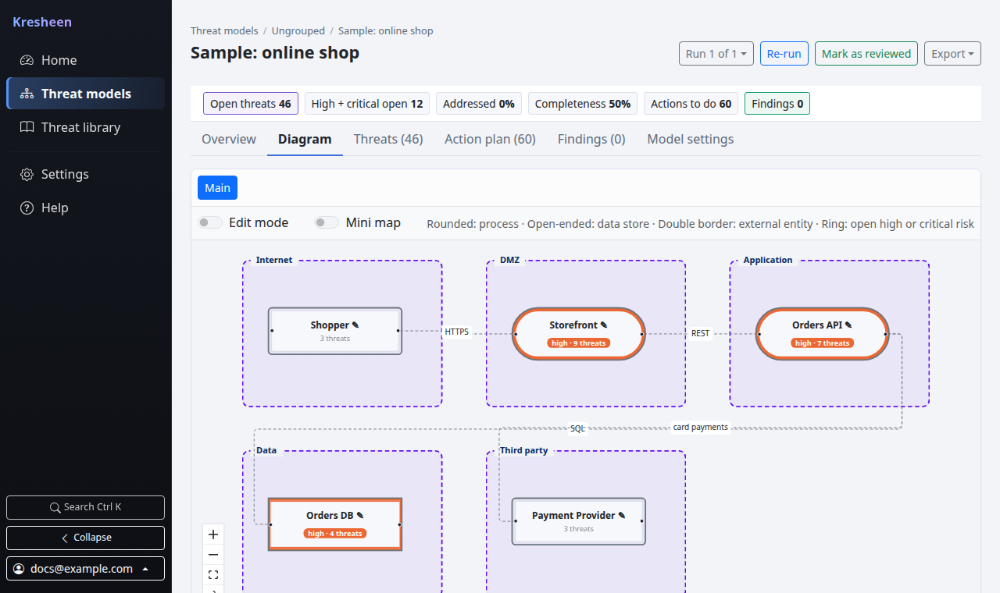

# Kresheen

Open-source threat modeling and security analysis platform by Pecka Cyber.

Kresheen builds a threat model of a system you describe, draw or upload: a data flow diagram with trust boundaries, the threats that follow from that design, vulnerabilities found in what you provided, and a ranked plan for fixing them. You host it yourself. It runs as one FastAPI service with a React web interface and keeps its data in SQLite or PostgreSQL.



## Quickstart (about 5 minutes)

You need Docker with Compose v2 and Git. The first build takes a few minutes.

```bash
git clone https://github.com/PeckaCyber/kresheen.git
cd kresheen

# A key that encrypts secrets stored by the app (back it up).
echo "KRESHEEN_SECRET_KEY=$(openssl rand -base64 32 | tr '+/' '-_')" > .env

docker compose up -d --build
docker compose run --rm app create-user --email you@example.com
```

`create-user` prints a generated password once. Open <http://127.0.0.1:8000>, sign in, click **Create your first threat model**, then **Explore a sample model** to see what results look like.

This setup is for trying Kresheen on your own machine: it listens on 127.0.0.1 only, and its bundled PostgreSQL uses a fixed local password. `./install.sh` runs the same steps interactively and also supports Kubernetes. For a shared or production install (TLS, your own database, backups), Helm, or installing from source, see [docs/installation.md](docs/installation.md).

## What it does

- **Reads what you have.** Kubernetes YAML, Terraform plan JSON, a GitHub repository (Kubernetes manifests plus a dependency vulnerability scan with Grype), and diagrams from Threat Dragon, draw.io, Mermaid and Threagile.
- **Or starts from nothing.** Answer a few plain questions for a starter model, or draw it on a blank canvas.
- **Data flow diagrams you can edit.** Multiple diagrams per model, trust boundaries, and stated facts about each component (for example "stores card data" or "requires authentication").
- **Rule-based threats.** STRIDE threats for every element of the diagram, a few misconfiguration checks for Kubernetes and AWS, and your own custom threats. The same input always gives the same threats. The rule text is written for this project; see [NOTICE](NOTICE) for the references it cites.
- **Risk and a plan.** Risk scoring, attack paths, a completeness check that asks for the facts the model is missing, and an action plan that groups threats by the fix that addresses them.
- **Tracking over time.** Run history, differences between runs, stale-model detection, and a per-model trend.
- **Exports.** PDF, Word and HTML reports, CSV, SARIF, SVG and PNG diagrams, and Threat Dragon JSON.
- **CI gate.** `kresheen ci` and a GitHub Action fail a pull request on newly introduced risk, using API tokens.
- **Teams.** Local users (owner and member), groups as shared workspaces, and an in-app audit log.

## How accurate is it?

Kresheen is rule-based. It does not guess. Its rules are checked against the project's own test cases, and the results change only when the input or the rules change. Rules read what your files declare, so they cannot see what a manifest does not say, such as a proxy in front of a service or a setting applied elsewhere. Answering the completeness questions makes the results fit your system better. Treat the output as a well-organised starting point for a review by a person, not as a finished assessment or a guarantee that nothing else is wrong.

## Optional AI assist (experimental)

With your own Anthropic API key, AI can suggest answers for the guided setup and explain a threat in plain words. It is off by default, only the instance owner can turn it on, and it never writes threats, findings or the model. Rule-based analysis works fully without it. See [docs/ai.md](docs/ai.md).

## Project status

Kresheen is at its first public release and growing. Expect the rules, data sources and documentation to expand with each release, guided by what people report. See [CHANGELOG.md](CHANGELOG.md) for what changed.

## Kresheen Pro (coming soon)

Kresheen Pro is a separate edition for organisations that need more. It is not available yet. It is planned to add:

- single sign-on (OIDC), SCIM provisioning, group-to-role mapping and SSO-only mode
- restricted groups with viewer, editor and admin roles
- an extended threat knowledge base, including the full set of Kubernetes and AWS misconfiguration checks
- extended methodology coverage beyond STRIDE
- reviewed guidance with verification steps and example fixes
- a Jira connector
- a portfolio dashboard across models
- audit streaming to a SIEM and longer retention
- your organisation's own names for Kresheen's terms, such as trust boundaries

The open-source edition in this repository is complete on its own and has no licence checks.

## Bugs and feature requests

Open a [GitHub issue](https://github.com/PeckaCyber/kresheen/issues/new/choose) and pick the bug report or feature request template. This repository does not accept pull requests from outside contributors yet. See [CONTRIBUTING.md](CONTRIBUTING.md).

By submitting an issue, you agree that Pecka Cyber LLC may freely use your feedback or feature idea in any open-source or commercial version of the tool without restriction or compensation.

## Contact

For anything that should not be public, email **support@peckacyber.com**:

- a potential security vulnerability: see [SECURITY.md](SECURITY.md), and please do not open a public issue for it, so it can be fixed first
- questions about enterprise use or the upcoming Kresheen Pro

## Documentation

- [Installation](docs/installation.md): Compose, Helm, from source
- [Configuration](docs/configuration.md): every environment variable
- [User guide](docs/user-guide.md)
- [Data sources](docs/data-sources.md): what each source reads and ignores
- [CI integration](docs/ci-integration.md)
- [CLI reference](docs/cli-reference.md)
- [Upgrading](docs/upgrading.md)
- [Releases](docs/releases.md): how releases are made and how to verify them
- [Security guide for operators](docs/security.md)
- [AI assist](docs/ai.md)
- [Architecture](docs/architecture.md)

All docs are indexed in [docs/README.md](docs/README.md).

## Licence

Apache License 2.0. Copyright Pecka Cyber LLC. See [LICENSE](LICENSE).
